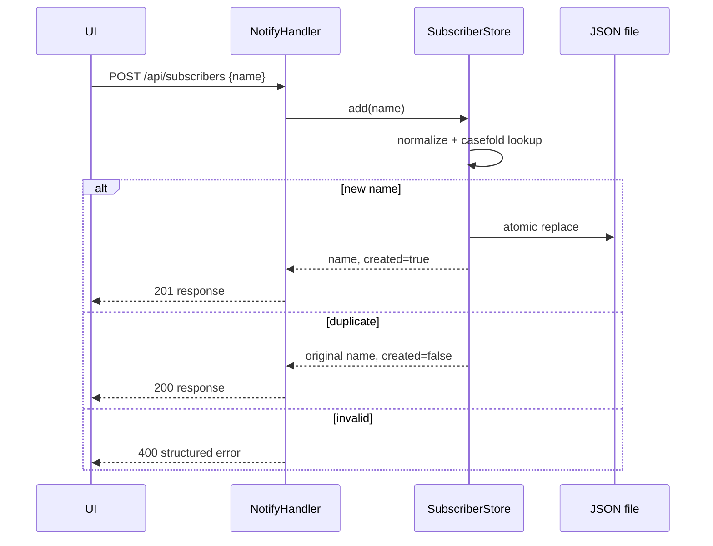

# Design: subscriber logic

`SubscriberStore` владеет нормализацией, уникальностью, сортировкой и атомарной записью.
`NotifyHandler` переводит HTTP в операции store и формирует только ответы из общего
контракта. Store внедряется в server, поэтому тесты используют память или временный файл.

Потокобезопасность внутри процесса обеспечивается `RLock`; это не обещает распределённую
согласованность и соответствует узким границам учебного сервиса.

