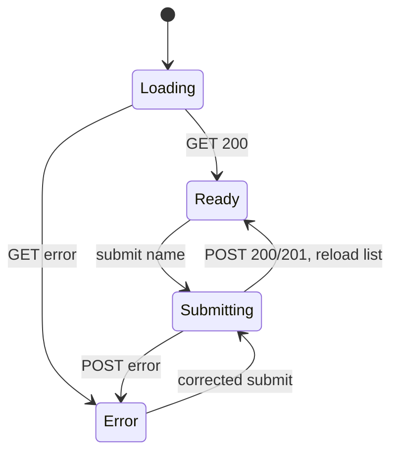

# Design: subscriber UI

UI состоит из формы, live-status, счётчика и списка. Источник истины — ответы API по
[`common-contract.md`](../../../specs/common-contract.md); после успешного POST список
перечитывается, поэтому optimistic state не расходится с backend.

Решение по доступности: `label` связан с input; сообщения объявляются через `role=status` и
`aria-live`; native button получает `disabled` только на время запроса.

