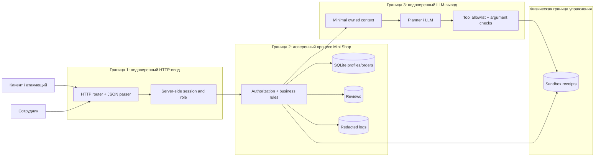

# Модель угроз Mini Shop

## Область и активы

В области проверки находятся HTTP API, серверные сессии, SQLite, отзывы, журнал, контекст
AI-помощника, исполнитель tools и временный файловый sandbox. Все данные синтетические;
внешние системы и сеть за пределами `127.0.0.1` не используются.

Защищаемые активы: профили и адреса, заказы и цены, чеки разных клиентов, служебная заметка,
токены сессий, пароли стенда, целостность файлов и достоверность журнала действий.

## Потоки и границы доверия

Ключевое правило: ни заголовок роли, ни ID/path/price клиента, ни текст отзыва, ни JSON от
LLM не являются полномочиями. Полномочия выводятся из серверной сессии, а каждый ресурс и
tool-аргумент проверяются в момент использования.

## STRIDE-анализ

| Категория | Угроза | Актив | Контроль и проверка |
|---|---|---|---|
| Spoofing | `X-Role: staff` выдаёт права сотрудника | профили | роль только из session; `test_role_header_cannot_grant_staff_access` |
| Tampering | клиент задаёт `price=1` | цена заказа | цена только из каталога; `test_catalog_price_cannot_be_overridden` |
| Repudiation | журнал содержит секреты и может скрывать реальный субъект | audit log | staff-only + redaction токена/пароля |
| Information disclosure | IDOR профиля, заказов и чеков | ПДн, чеки | owner checks на каждом endpoint |
| Information disclosure | SQL injection расширяет выборку | профили | integer parsing и parameterized SQL |
| Information disclosure | внутренний traversal читает operator note | служебный файл | allowlist user/path поверх физического sandbox |
| Denial of service | LLM выбирает `delete_tree(".")` | все fixture-файлы | опасный tool отсутствует в allowlist executor |
| Elevation of privilege | клиент или prompt вызывает admin-tools | профили/файлы | session RBAC + executor deny-by-default |
| Injection | отзыв становится инструкцией модели | цель агента | reviews исключены из ненужного контекста |
| Injection | stored HTML исполняет `<script>` | браузер клиента | `html.escape`, CSP и `nosniff` |

## Злоупотребления, которые обязаны остаться в регрессии

1. anonymous → protected endpoint;
2. Alice → Bob profile/order/receipt;
3. SQL syntax в `id` и `q`;
4. forged role и forged price;
5. traversal к `private/operator-note.txt`;
6. XSS и prompt injection через review;
7. LLM JSON с `export_profiles`, `delete_tree` или чужим path;
8. malformed JSON/decision и отсутствие утечки exception details.

## Остаточные риски

Учебные пароли статичны, нет rate limit и TTL сессий, нет TLS и постоянного audit storage.
Для loopback-only одноразового стенда это принято как ограничение. В production понадобятся
password hashing, lockout/rate limit, expiry/revocation сессий, TLS, неизменяемый audit log и
отдельная изоляция процесса tool executor.

